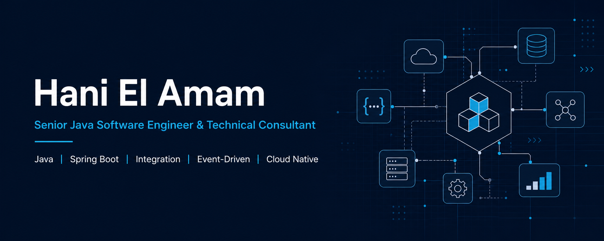

**Senior Java Software Engineer | Technical Consultant | Amsterdam**

I am a software engineer and technical consultant with more than 11 years of experience building, integrating and improving software systems in complex enterprise environments.

My work sits at the intersection of business and technology. I translate requirements and process challenges into maintainable backend services, integration solutions and practical technical designs. I am available for freelance assignments involving Java development, system integration and backend modernization.

## Expertise

| Area | Technologies and skills |
| --- | --- |
| Backend development | Java 21, Spring Boot, REST APIs, microservices, JPA, Hibernate |
| Integration | Apache Camel, Kafka, ActiveMQ Artemis, XML, JSON, SFTP |
| Security | OAuth2, OpenID Connect, JWT, Keycloak |
| Data | PostgreSQL, Microsoft SQL Server, MongoDB, Flyway |
| Cloud and delivery | Docker, Kubernetes, OpenShift, Terraform, Azure, CI/CD |
| Engineering | Domain modelling, automated testing, observability, resilience |
| Consultancy | Requirements analysis, impact analysis, technical design, process optimization |

## Portfolio

### [ServiceDesk Cloud Platform](https://github.com/itqaanconsulting/servicedesk-cloud-platform)

Cloud-native service desk implemented as three independently deployable Spring Boot microservices.

**Demonstrates:** microservice boundaries, resilient service communication, assignment notifications, PostgreSQL, distributed tracing, Prometheus, Grafana, Docker, Kubernetes, Terraform and Azure Container Apps.

### [OrderFlow Events](https://github.com/itqaanconsulting/orderflow-events)

Event-driven order processing platform using Kafka for asynchronous lifecycle execution.

**Demonstrates:** Kafka producers and consumers, transactional outbox, idempotency, retries, dead-letter topics, Testcontainers and failure recovery.

### [Camel Integration Hub](https://github.com/itqaanconsulting/camel-integration-hub)

Integration hub that accepts REST, CSV and SFTP input, normalizes it to a canonical model and delivers it to an external HTTP API.

**Demonstrates:** Apache Camel, enterprise integration patterns, canonical data transformation, retry policies, persistent dead-letter handling, manual reprocessing and WireMock integration tests.

### [FreelanceFlow API](https://github.com/itqaanconsulting/freelanceflow-api)

Secured administration platform for customers, projects, time entries, approvals and invoice generation.

**Demonstrates:** REST API design, workflow-oriented domain modelling, Keycloak security, role-based authorization, audit logging, PDF generation, PostgreSQL and Flyway.

### [LogScope Desktop](https://github.com/itqaanconsulting/logscope-desktop)

Local JavaFX application for searching, filtering and analysing application logs without uploading operational data.

**Demonstrates:** JavaFX, asynchronous file processing, multiple log formats, stacktrace parsing, timelines, saved filters, CSV export and Windows packaging with `jpackage`.

## Professional Approach

- Build maintainable solutions around clear domain and service boundaries.
- Treat validation, security, observability and failure handling as part of the design.
- Communicate technical trade-offs clearly to developers and non-technical stakeholders.
- Improve existing systems pragmatically instead of rewriting without a business reason.

## Background

- MSc Econometrics, University of Amsterdam
- Experience in government and commercial enterprise environments
- Languages: Dutch, English and Arabic
- Based in Amsterdam, the Netherlands

## Contact

For freelance Java, backend or integration assignments, connect with me through my GitHub profile.

For a guided overview, see the [portfolio presentation guide](PORTFOLIO-GUIDE.md).
